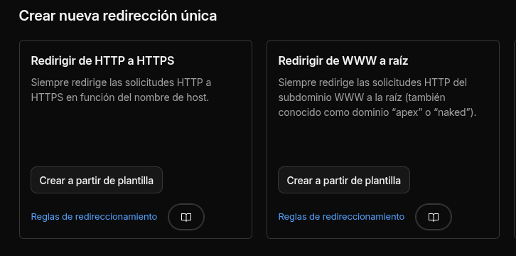

# Guía: subir una web estática a Cloudflare

Cómo se despliega kcurtet.com y cómo hacerlo desde cero para cualquier web estática.

Dos opciones en Cloudflare:

- **Workers con Static Assets** (recomendado por Cloudflare hoy, la que usa este repo): `wrangler.jsonc` + `wrangler deploy`. Sirve estáticos desde la red global con la misma infra que los Workers.
- **Cloudflare Pages** (clásico): dashboard o integración Git. Sigue funcionando pero el desarrollo nuevo se centra en Workers Assets.

Aquí se documenta la vía Workers Assets con Wrangler, que es la que está configurada.

## 1. Prerrequisitos

- Cuenta de Cloudflare (gratis vale para empezar).
- Node ≥ 22 (ver `engines` en `package.json`).
- Wrangler instalado como dependencia: `npm install -D wrangler`.
- El dominio añadido a la cuenta de Cloudflare (Dashboard → *Add a site*). Si el dominio está en otro registrar, apunta sus nameservers a los que te da Cloudflare.

## 2. Compilar la web

Para Astro (este repo):

```sh
npm run build
```

Genera `dist/` con el sitio completo. Cualquier otra herramienta vale mientras produzca una carpeta de estáticos (Vite `dist/`, Hugo `public/`, Next `out/`, etc.).

## 3. Configurar wrangler.jsonc

Configuración de este repo (`wrangler.jsonc` en la raíz):

```jsonc
{
	"$schema": "node_modules/wrangler/config-schema.json",
	"name": "kcurtet-com",
	"compatibility_date": "2026-11-05",
	"assets": {
		"directory": "./dist",
		"not_found_handling": "404-page" // sirve dist/404.html en rutas inexistentes
	},
	"routes": [
		{ "pattern": "kcurtet.com", "custom_domain": true },
		{ "pattern": "www.kcurtet.com", "custom_domain": true }
	]
}
```

Claves:

- `assets.directory`: carpeta con los estáticos compilados.
- `not_found_handling`: `"404-page"` (usa `404.html`) o `"single-page-application"` (sirve `index.html` para todo, apps SPA). Por defecto es `"none"` (404 plano).
- `routes` con `custom_domain: true`: crea automáticamente el dominio personalizado y el certificado TLS al desplegar. Sin esto, la web queda en `kcurtet-com.<subdominio>.workers.dev`.

## 4. Autenticación y despliegue

```sh
npx wrangler login   # primera vez: abre el navegador para autorizar
npx wrangler deploy  # sube dist/ y publica
```

En este repo hay un atajo:

```sh
npm run deploy   # astro build && wrangler deploy
```

El primer `deploy` de la sesión pide login interactivo. En CI (sin navegador) usa un token: `CLOUDFLARE_API_TOKEN` en las variables de entorno del runner con permisos *Workers Scripts:Edit* y *Account Settings:Read* (o el template "Edit Cloudflare Workers").

## 5. Redirección de www → dominio raíz

Hecha con una **Redirect Rule** del dashboard (zona kcurtet.com), sin código ni workers extra. Requiere:

1. Registro DNS proxied: `www` CNAME → `kcurtet.com` (nube naranja). Sin registro proxied la regla no se evalúa.
2. Dashboard → zona kcurtet.com → *Rules → Redirect Rules → Create rule*: hay plantillas recomendadas — usa **"Redirigir de WWW a raíz"** (y "Redirigir de HTTP a HTTPS" si la zona no sube ya el tráfico a HTTPS, que Cloudflare hace por defecto).

   

   Si prefieres la expresión a mano: Hostname equals `www.kcurtet.com` → Dynamic redirect a `concat("https://kcurtet.com", http.request.uri.path)`, estado 301, preservar query string.

Resultado: `www.kcurtet.com/<path>` → 301 → `https://kcurtet.com/<path>`. Solo el dominio raíz es canónico.

Nota (verificado empíricamente): las Redirect Rules se evalúan **antes** de que el request llegue al worker. Por eso `www` figura también como custom domain en `wrangler.jsonc`: aunque el hostname esté adjuntado al worker, la regla dispara (301) y el worker no llega a servir ese hostname. El único requisito duro de la regla es el registro DNS proxied: si `www` no resuelve, no se evalúa.

## 6. DNS

Al usar `custom_domain: true`, Cloudflare crea los registros DNS necesarios y el certificado automáticamente. Verificación: Dashboard → tu dominio → *DNS* debe mostrar registros para `kcurtet.com` (y `www`) apuntando al Worker, proxied (nube naranja).

Si prefieres controlarlo a mano: crea el registro A/AAAA y luego asocia el dominio desde el Worker → *Settings → Domains & Routes → Add → Custom domain*.

## 7. Alternativas sin Wrangler

- **Dashboard directo**: Workers & Pages → *Create → Workers Assets → Upload assets*: subes el contenido de `dist/` arrastrando. Vale para publicar sin herramientas, pero no es reproducible.
- **Integración Git (Workers Builds o Pages)**: conectas el repo, defines el comando de build (`npm run build`) y la carpeta de salida (`dist`). Cada push despliega. útil si no quieres CI propio; este repo no lo usa porque despliega explícito con `npm run deploy`.

## 8. Automatizar con GitHub Actions

```yaml
name: deploy
on:
  push:
    branches: [main]
jobs:
  deploy:
    runs-on: ubuntu-latest
    steps:
      - uses: actions/checkout@v4
      - uses: actions/setup-node@v4
        with:
          node-version: 22
      - run: npm ci
      - run: npm run deploy
        env:
          CLOUDFLARE_API_TOKEN: ${{ secrets.CLOUDFLARE_API_TOKEN }}
```

Guardar el token en *Settings → Secrets → Actions*.

## 9. Problemas comunes

- **404 en todas las rutas**: falta `not_found_handling` o no existe `dist/404.html`.
- **"wrangler is not authenticated"**: `npx wrangler login`, o define `CLOUDFLARE_API_TOKEN` en CI.
- **Redirect rule de www no dispara**: casi siempre falta el registro DNS de `www` proxied (nube naranja). Sin registro que resuelva, la regla no se evalúa. Que el hostname esté además adjuntado a un worker no lo impide.
- **Dominio no se adjunta**: el dominio tiene que estar en la misma cuenta de Cloudflare y con DNS en ella; si no, `custom_domain` falla.
- **Cambios que no se ven**: los assets se cachean en el edge. Los archivos van con hash en el nombre (Astro lo hace), pero ficheros sin hash (`rss.xml`, `sitemap`) pueden tardar en refrescar.
- **Node incorrecto**: este repo exige Node ≥ 22 (`engines`); con versiones viejas el build de Astro falla.
